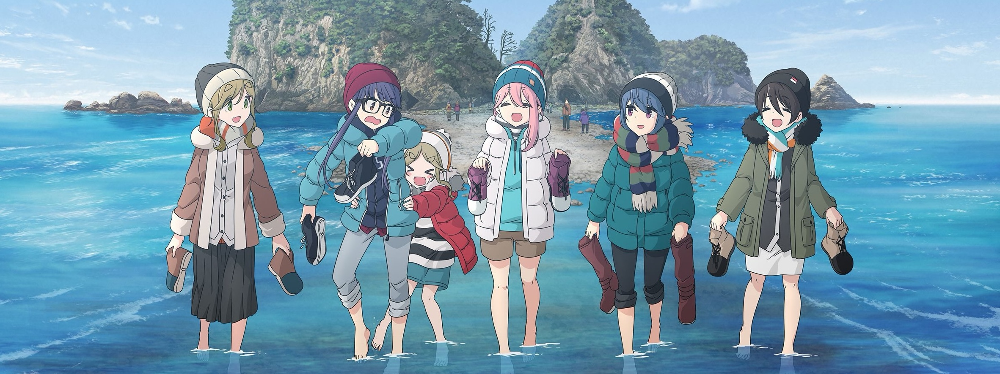

<div align="center">

<!-- Banner Image -->


<br />

<!-- Typing SVG -->
<a href="https://github.com/kahonanami">
  
</a>

<!-- Social & Contact Badges -->
<p>
  <a href="mailto:azusaq@qq.com">
    
  </a>
  <a href="https://azusaq.moe" target="_blank">
    
  </a>
  
</p>

</div>

---

### 👨‍💻 About Me

```yaml
handle: Azusaq
education:
  university: China University of Mining and Technology (CUMT)
  major: Information Security (Undergrad, 2024–Present)
focus:
  - AI for Security & Security for AI
  - Binary Analysis & Reverse Engineering
hobbies:
  - Anime (CGDCT, Light Yuri & Romance) 🌸
  - Gaming (Action Games, Counter-Strike) 🎮
```

---

### 🛠️ Tech Stack

<div align="center">
  
</div>

<div align="center" style="margin-top: 10px;">
  
  
  
</div>

---

### 🏆 Awards

- 🥉 **18th National College Student Information Security Competition (CISCN)**  
  *National Third Prize, Finals (2025)*
- 🥈 **19th National College Student Information Security Competition (CISCN)**  
  *Second Prize, Semifinals (2026)*

---

### 📊 GitHub Stats

<div align="center">
  
  
</div>

</div>
